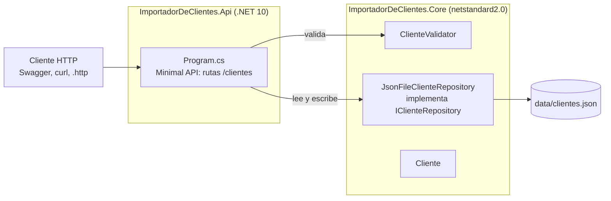

# API REST de clientes (`ImportadorDeClientes.Api`)

## 1. Qué es y para qué sirve

Una API HTTP para **consultar, dar de alta, modificar y borrar clientes**. Los datos se guardan en un fichero JSON en disco; no hay base de datos.

Cada cliente se identifica por su **DNI**, que es único.

| Campo | Tipo | Ejemplo |
|---|---|---|
| `dni` | texto | `"12345678Z"` |
| `nombre` | texto | `"Ana"` |
| `apellidos` | texto | `"García López"` |
| `fechaNacimiento` | fecha | `"1990-04-12"` |
| `telefono` | texto | `"612345678"` |
| `email` | texto | `"ana@example.com"` |

## 2. Qué permite hacer (endpoints)

Todas las rutas cuelgan de `/clientes`.

| Método | Ruta | Qué hace | Respuestas |
|---|---|---|---|
| `GET` | `/clientes` | Lista todos los clientes | `200` con un array (vacío si no hay clientes) |
| `GET` | `/clientes/{dni}` | Devuelve un cliente | `200` con el cliente · `404` si no existe |
| `POST` | `/clientes` | Da de alta un cliente | `201` con el cliente y la cabecera `Location` · `400` si los datos no son válidos o el DNI ya existe |
| `PUT` | `/clientes/{dni}` | Sustituye un cliente entero | `200` con el cliente · `400` si los datos no son válidos o el DNI del cuerpo no coincide con el de la URL · `404` si no existe |
| `DELETE` | `/clientes/{dni}` | Borra un cliente | `204` sin cuerpo · `404` si no existe |

Detalles a tener en cuenta:

- **El DNI no distingue mayúsculas ni espacios.** `/clientes/12345678z` y `/clientes/12345678Z` son el mismo cliente. Al guardar, el DNI se pasa a mayúsculas y se quitan los espacios de los extremos.
- **`PUT` no hace actualizaciones parciales.** Hay que enviar el cliente completo, con todos los campos. El `dni` del cuerpo debe ser el de la URL: el DNI no se puede cambiar, porque es la clave.
- **Fechas.** En las respuestas siempre salen como `yyyy-MM-dd`. Al enviarlas se aceptan `yyyy-MM-dd` (`1990-04-12`), `dd/MM/yyyy` (`12/04/1990`) y `yyyy-MM-ddTHH:mm:ss`.

### Reglas de validación (`POST` y `PUT`)

| Campo | Regla |
|---|---|
| `dni` | Obligatorio. La letra no se comprueba, porque el enunciado solo pide que no esté vacío. |
| `nombre` | Obligatorio, como máximo 100 caracteres |
| `apellidos` | Obligatorio, como máximo 150 caracteres |
| `fechaNacimiento` | Obligatoria, no puede ser futura ni anterior a 1900 |
| `telefono` | 9 dígitos que empiezan por 6, 7, 8 o 9, opcionalmente con `+34`. Se ignoran los espacios y los guiones. |
| `email` | Formato `algo@dominio.ext` |

Si hay errores, la respuesta es un `400` con el formato estándar *ValidationProblem*. Agrupa **todos** los errores por campo, no solo el primero:

```json
{
  "title": "One or more validation errors occurred.",
  "status": 400,
  "errors": {
    "telefono": ["El teléfono debe tener 9 dígitos (opcionalmente con +34)."],
    "email": ["El email no tiene un formato válido."]
  }
}
```

El DNI duplicado se devuelve con el mismo formato: `"dni": ["Ya existe un cliente con DNI 12345678Z."]`.

Si el cuerpo ni siquiera se puede leer, la respuesta es también un `400` con el mismo formato:

| Caso | Error devuelto |
|---|---|
| Fecha imposible, por ejemplo `"1997-30-03"` | `"fechaNacimiento": ["Fecha '1997-30-03' no válida (…)"]` |
| JSON mal formado, por ejemplo una coma final | `"cuerpo": ["El cuerpo no es un JSON válido (línea 3, posición 1)."]` |
| Sin cuerpo, o sin `Content-Type: application/json` | `"cuerpo": ["Falta el cuerpo de la petición o no es JSON (…)"]` |

## 3. Arquitectura



La API es una capa fina: recibe la petición, delega y traduce el resultado a un código HTTP. **Las reglas de negocio no están en la API**, sino en `ImportadorDeClientes.Core`, que comparte con la aplicación de escritorio. Así, un cliente válido para la API lo es también para el escritorio, y al revés.

### Piezas

| Pieza | Dónde | Responsabilidad |
|---|---|---|
| `Program.cs` | Api | Configura los servicios, define las 5 rutas y convierte los resultados en respuestas HTTP |
| `FechaJsonConverter` | Api (`Program.cs`) | Lee y escribe las fechas en los formatos descritos arriba |
| `AErrores(...)` | Api (`Program.cs`) | Convierte los errores del validador al diccionario `campo → mensajes` del *ValidationProblem*, con los nombres en camelCase |
| Middleware `app.Use(...)` + `ErroresDeCuerpo(...)` | Api (`Program.cs`) | Captura la `BadHttpRequestException` que lanza ASP.NET Core cuando no puede leer el cuerpo y la convierte en el mismo *ValidationProblem*. Con `ThrowOnBadRequest = true` se comporta igual en Development que en producción. |
| `Cliente` | Core/Modelos | Modelo de datos. Normaliza el DNI (quita espacios y lo pasa a mayúsculas). |
| `ClienteValidator` | Core/Validacion | Aplica las reglas de la tabla anterior. Nunca lanza excepciones por datos incorrectos: devuelve un `ResultadoValidacion` con la lista de errores. |
| `IClienteRepository` | Core/Almacenamiento | Contrato de almacenamiento: `GetAll`, `GetByDni`, `Add`, `Update`, `Delete`, `SaveAll` |
| `JsonFileClienteRepository` | Core/Almacenamiento | Implementación sobre un fichero JSON |

### Flujo de una petición `POST /clientes`

1. ASP.NET Core deserializa el cuerpo a `Cliente`. Las fechas pasan por `FechaJsonConverter`. Si el cuerpo no se puede leer → `400` (ver la tabla de la sección 2).
2. `ClienteValidator.Validar` comprueba el cliente. Si hay errores → `400` con todos los errores.
3. `repo.Add(cliente)` devuelve `false` si el DNI ya existe → `400` con el error en `dni`.
4. Si todo va bien → `201 Created`, con la cabecera `Location: /clientes/{dni}` y el cliente.

### Inyección de dependencias

Ambos servicios se registran como **singleton**, una única instancia para toda la aplicación:

- **`IClienteRepository` → `JsonFileClienteRepository`.** La ruta del fichero se lee de la configuración `Storage:Path` y es relativa a la carpeta del proyecto.
- **`ClienteValidator`.** No guarda estado, así que una única instancia basta.

Los handlers reciben los servicios como parámetros (`(IClienteRepository repo, ClienteValidator validator) => ...`), y ASP.NET Core los inyecta automáticamente.

Usan `TypedResults` y declaran los posibles resultados, por ejemplo `Results<Ok<Cliente>, NotFound>`. Así OpenAPI y Swagger documentan solos los códigos que puede devolver cada endpoint.

### Almacenamiento: cómo funciona el fichero

`JsonFileClienteRepository` trata el fichero como **la única fuente de verdad**:

- **Lee el fichero en cada operación**, sin caché. Si editas el fichero a mano con la API arrancada, la siguiente petición ya ve el cambio.
- **Escribe de forma atómica.** Primero escribe `clientes.json.tmp` y después lo sustituye por el original (`File.Replace`). Si el proceso se corta a mitad, el fichero bueno no queda a medias.
- **Usa un `lock`** para que dos peticiones simultáneas no se pisen al leer, modificar y escribir.
- **Si el fichero no existe, lo crea** con `[]`. Si existe pero no es JSON válido, lanza `InvalidDataException`.
- **Guarda las fechas como `yyyy-MM-dd`**, con sangría para que se pueda leer.

## 4. Configuración

| Fichero | Qué contiene |
|---|---|
| `appsettings.json` | `Storage:Path` = `data/clientes.json` (ruta del fichero de datos) |
| `Properties/launchSettings.json` | Perfil `http` en `http://localhost:5261` y perfil `https` en `https://localhost:7017`. Los dos arrancan en Development y abren Swagger. |
| `ImportadorDeClientes.Api.http` | Peticiones de ejemplo para lanzarlas desde Visual Studio |

En **Development** se publican además:

- `/openapi/v1.json`, el documento OpenAPI generado por `Microsoft.AspNetCore.OpenApi`;
- `/swagger`, la interfaz Swagger UI para probar la API desde el navegador;
- `/`, que redirige a `/swagger`.

## 5. Cómo arrancarla y probarla

```powershell
dotnet run --project ImportadorDeClientes.Api --launch-profile http
```

Abre `http://localhost:5261/swagger`. En Visual Studio basta con poner `ImportadorDeClientes.Api` como proyecto de inicio y pulsar F5.

Ejemplo de alta con curl:

```powershell
curl -X POST http://localhost:5261/clientes -H "Content-Type: application/json" -d '{
  "dni": "12345678Z", "nombre": "Ana", "apellidos": "García López",
  "fechaNacimiento": "1990-04-12", "telefono": "612345678", "email": "ana@example.com"
}'
```

### Tests automáticos

En `ImportadorDeClientes.Tests/ClientesApiTests.cs`. Levantan la API en memoria con `WebApplicationFactory<Program>`, cada test con su propio fichero temporal. Comprueban:

- `POST` duplicado → `400`;
- `POST` con datos inválidos → `400` con un error por campo;
- `POST` con una fecha imposible → `400` con el error en `fechaNacimiento`;
- `GET` de un DNI inexistente → `404`;
- `DELETE` → `204` y, si se repite, `404`.

```powershell
dotnet test ImportadorDeClientes.Api.slnx
```

## 6. Decisiones y límites

- **Fichero JSON y no base de datos**, porque lo pide el enunciado. Para cambiarlo basta con otra implementación de `IClienteRepository`: los endpoints no cambiarían.
- **Re-leer el fichero en cada operación** es sencillo y siempre está al día, pero no escala a muchos datos. Para una prueba técnica es suficiente.
- **El `lock` protege solo dentro de un proceso.** Si dos procesos escriben el mismo fichero a la vez, por ejemplo la API y la app de escritorio apuntando a la misma ruta, uno puede pisar al otro. Por defecto usan ficheros distintos.
- **Sin autenticación**: no la pide el enunciado.
