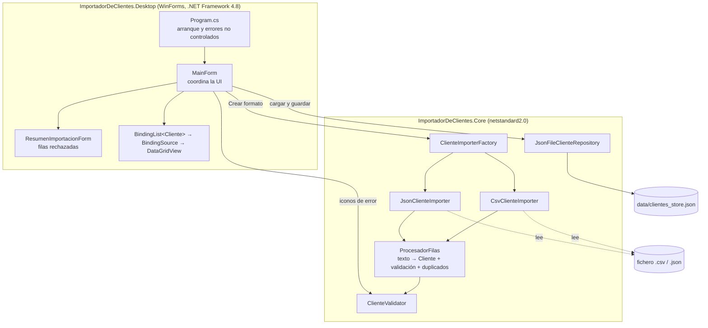
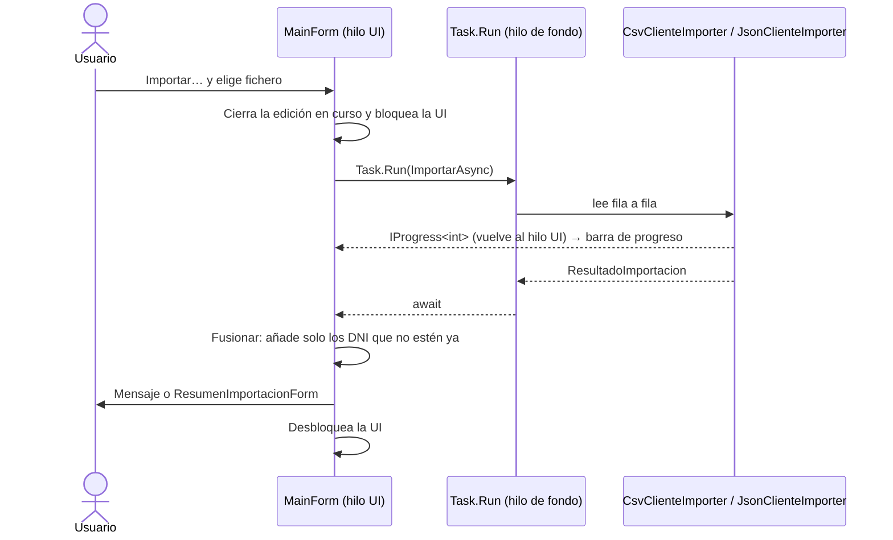

# Aplicación de escritorio (`ImportadorDeClientes.Desktop`)

## 1. Qué es y para qué sirve

Una aplicación **Windows Forms (.NET Framework 4.8)** para **importar clientes desde ficheros CSV o JSON**, revisarlos y corregirlos en una tabla editable, y guardarlos en disco. Los datos se conservan entre sesiones: al cerrar se guardan y al abrir se cargan solos.

Trabaja con los mismos clientes y las mismas reglas que la API (DNI, nombre, apellidos, fecha de nacimiento, teléfono y email), porque las dos comparten el proyecto `ImportadorDeClientes.Core`. Las reglas están detalladas en [Api.md](Api.md#reglas-de-validación-post-y-put).

## 2. Qué permite hacer

### Pantalla principal

```
┌──────────────────────────────────────────────────────────────────────────┐
│ Formato: [CSV ▾] [Importar…] [Cancelar]  [Añadir] [Eliminar] [Guardar]   │ ← barra de herramientas
├──────────────────────────────────────────────────────────────────────────┤
│ DNI       │ Nombre │ Apellidos     │ F. nacimiento │ Teléfono  │ Email   │
│ 12345678Z │ Ana    │ García López  │ 12/04/1990    │ 612345678 │ ana@…   │ ← tabla editable
│ 87654321X │ Luis   │ Pérez         │ 03/11/1985    │ 51234 (!) │ luis@…  │   (!) = icono de error
│ *         │        │               │               │           │         │ ← fila nueva
├──────────────────────────────────────────────────────────────────────────┤
│ [████████░░] 2 clientes · 1 con errores   Importados 2 de clientes.csv   │ ← barra de estado
└──────────────────────────────────────────────────────────────────────────┘
```

### Importar un fichero

1. Elige el formato (**CSV** o **JSON**) en el desplegable y pulsa **Importar…**.
2. Selecciona el fichero. Mientras se lee, la barra de progreso avanza y la tabla se bloquea. **Cancelar** detiene la importación sin tocar la lista.
3. Al terminar:
   - los clientes válidos se **añaden** a los que ya había en la tabla;
   - si un DNI ya está en la tabla, no se duplica: se cuenta como "omitido";
   - si no hubo errores, se muestra un mensaje con los totales;
   - si los hubo, se abre la ventana **Resumen de importación** con los totales y una tabla de las filas rechazadas (línea, DNI y motivo), y el botón **Copiar** lleva esa lista al portapapeles.

Formato de los ficheros (en `ejemplos/` hay muestras):

- **CSV:**
  - Cabecera obligatoria y exacta: `dni,nombre,apellidos,fechaNacimiento,telefono,email`. No distingue mayúsculas.
  - Separador `,`. Los campos pueden ir entre comillas para incluir comas, y `""` dentro de un campo es una comilla.
  - Las líneas vacías se ignoran.
- **JSON:** un array de objetos con esos mismos nombres de propiedad. Tampoco distingue mayúsculas.
- **Fechas:** se aceptan `yyyy-MM-dd`, `dd/MM/yyyy` y `yyyy-MM-ddTHH:mm:ss`.

Qué pasa con los errores:

| Situación | Resultado |
|---|---|
| Una fila con datos no válidos | Se rechaza **esa fila** con su número de línea y el motivo. El resto se importa. |
| DNI repetido dentro del mismo fichero | Se queda el primero. Los siguientes se rechazan como "DNI repetido dentro del fichero". |
| Fichero entero no válido (cabecera CSV incorrecta, JSON mal formado o vacío, o el fichero no se puede leer) | Mensaje de error. **No se importa nada.** |

### Editar en la tabla

- **Modificar:** haz clic en una celda y escribe. Las fechas se escriben como `dd/MM/yyyy`, aunque también se acepta `yyyy-MM-dd`.
- **Añadir:** escribe en la última fila, la marcada con `*`, o pulsa **Añadir**, que te lleva a ella.
- **Eliminar:** selecciona una o varias filas y pulsa **Eliminar** o la tecla `Supr`. Siempre pide confirmación.
- **Errores visibles:**
  - cada celda con un dato no válido muestra un **icono rojo**, y al pasar el ratón por encima aparece el motivo;
  - la barra de estado cuenta cuántos clientes tienen errores.
- **El DNI es la clave.** No puedes salir de una fila con el DNI vacío o repetido. Escríbelo, o pulsa `Esc` para descartar una fila nueva.

### Guardar y cargar

- Los datos se guardan en `data\clientes_store.json`, junto al ejecutable. En Visual Studio está en `ImportadorDeClientes.Desktop\bin\Debug\net48\data\`.
- **Al abrir**, la app carga ese fichero automáticamente.
- **Al cerrar**, si hay cambios sin guardar, los guarda. Si hay clientes con errores, pregunta primero si quieres guardar igualmente o volver para corregirlos.
- **Guardar** guarda en cualquier momento. El título de la ventana lleva `*` mientras hay cambios sin guardar.
- **Si el fichero está dañado** (no es JSON válido), no se borra: se renombra a `clientes_store.corrupto-<fecha>.json`, se avisa y la app arranca con la lista vacía.
- **Si ocurre un error inesperado**, la app no se cierra en silencio: muestra un mensaje y guarda el detalle en `data\errores.log`.

## 3. Arquitectura



**Idea principal:** el formulario solo coordina la interfaz. Toda la lógica está en `Core` y se puede probar sin abrir ninguna ventana:

- leer CSV o JSON;
- convertir textos en fechas;
- validar;
- detectar duplicados;
- guardar en disco.

La API usa ese mismo `Core`.

### Piezas del proyecto Desktop

| Fichero | Responsabilidad |
|---|---|
| `Program.cs` | Punto de entrada. Registra un manejador global de errores (`Application.ThreadException` y `AppDomain.UnhandledException`) que muestra un mensaje y escribe en `data\errores.log`. |
| `MainForm.cs` | La lógica de la ventana: importar, fusionar, editar, validar visualmente, cargar y guardar |
| `MainForm.Designer.cs` | Controles generados por el diseñador: barra de herramientas, tabla, barra de estado, diálogo de abrir fichero |
| `ResumenImportacionForm(.Designer).cs` | Ventana del resumen de importación, con la tabla de errores y el botón Copiar |

### Piezas de Core que usa

| Clase | Qué hace |
|---|---|
| `IClienteImporter` | Contrato `ImportarAsync(Stream, IProgress<int>, CancellationToken)` → `ResultadoImportacion` |
| `ClienteImporterFactory` | Devuelve `CsvClienteImporter` o `JsonClienteImporter` según el formato elegido |
| `CsvClienteImporter` / `JsonClienteImporter` | Leen el fichero **fila a fila**, sin cargarlo entero, e informan del progreso según la posición en el stream |
| `ProcesadorFilas` | Común a los dos formatos: crea el `Cliente`, interpreta la fecha, valida y descarta los DNI repetidos en el fichero |
| `ResultadoImportacion` | `Clientes` válidos + `Errores` (línea, DNI, motivo) + número de duplicados |
| `FormatoFicheroException` | Se lanza cuando el fichero **entero** no vale. Los errores de una fila no lanzan excepción: van a `Errores`. |
| `ClienteValidator` | Reglas de negocio. El formulario lo llama para pintar los iconos de error. |
| `JsonFileClienteRepository` | Lee y escribe `clientes_store.json`. Escribe de forma atómica con `.tmp` y sustitución. |

### Flujo de una importación



Puntos clave:

- **La lectura va fuera del hilo de la interfaz** (`Task.Run` + `async/await`), así que la ventana no se congela con ficheros grandes.
- **`Progress<int>` captura el hilo de la UI al crearse**, de modo que la barra se actualiza sin `Invoke` manual.
- **La cancelación** usa un `CancellationTokenSource`. El importador comprueba el token en cada fila, y si se cancela la lista no se modifica.
- **Mientras se importa no se puede editar ni cerrar la ventana**, para evitar estados a medias.

### Enlace de datos (binding)

```
BindingList<Cliente> _clientes  →  BindingSource  →  DataGridView
```

- `BindingList` avisa a la tabla de altas y bajas. La tabla edita directamente los objetos `Cliente`.
- Las columnas están definidas a mano (`AutoGenerateColumns = false`) para controlar el orden, los títulos y el formato.
- **Fechas:**
  - `CellFormatting` las muestra como `dd/MM/yyyy`;
  - `CellParsing` acepta los mismos formatos que la importación;
  - si el texto no es una fecha, `DataError` muestra un aviso y mantiene la celda en edición.
- **Iconos de error:** `CellErrorTextNeeded` valida el cliente de cada fila con `ClienteValidator` y muestra el mensaje del campo de esa celda. También marca los DNI repetidos en la lista.
- **`RowValidating`** impide salir de una fila con el DNI vacío o duplicado.
- **Recarga completa de la lista** (al arrancar o tras importar):
  - se rellena con los avisos desactivados, para no repintar 1 000 veces;
  - después se avisa con `bindingSource.ResetBindings(false)`.
- **La fila nueva (`*`).**
  - Al situarse en ella, la tabla crea un `Cliente` en blanco. Ese cliente no cuenta como cliente, no marca cambios y no se guarda.
  - Antes de importar o borrar, el formulario sale de la fila actual con `grid.CurrentCell = null`, como si el usuario pulsara fuera. Así es la tabla la que confirma la fila editada o descarta la vacía.
  - Si se cancela o confirma directamente en el `BindingSource`, la tabla se desincroniza de la lista. Eso era lo que causaba el cierre al hacer clic tras importar.

### Por qué .NET Framework 4.8 y `netstandard2.0`

- El enunciado pide WinForms sobre **.NET Framework 4.8**. El proyecto usa el formato *SDK-style*, así que compila también con `dotnet build`.
- `Core` es **`netstandard2.0`** porque es la única versión que pueden usar a la vez .NET Framework 4.8 (Desktop) y .NET 10 (API y tests).
- Por la misma razón, `Core` usa **Newtonsoft.Json**: `System.Text.Json` no viene incluido en .NET Framework.

## 4. Cómo ejecutarla y probarla

En Visual Studio: abre `ImportadorDeClientes.Desktop.slnx` → F5. Desde consola:

```powershell
dotnet build ImportadorDeClientes.Desktop.slnx
.\ImportadorDeClientes.Desktop\bin\Debug\net48\ImportadorDeClientes.Desktop.exe
```

Ficheros de prueba en `ejemplos/`:

| Fichero | Contenido |
|---|---|
| `clientes.csv` / `clientes.json` | 50 clientes válidos |
| `clientes_con_errores.csv` | 2 filas válidas y 7 con errores (fecha, teléfono, email, DNI vacío, DNI repetido, número de campos…) para ver el resumen de importación |

Para empezar de cero, borra `bin\Debug\net48\data\clientes_store.json`.

Los tests automáticos de `ImportadorDeClientes.Tests` cubren la lógica de `Core`: validación, importación CSV y JSON, y almacenamiento. La interfaz se prueba a mano.
